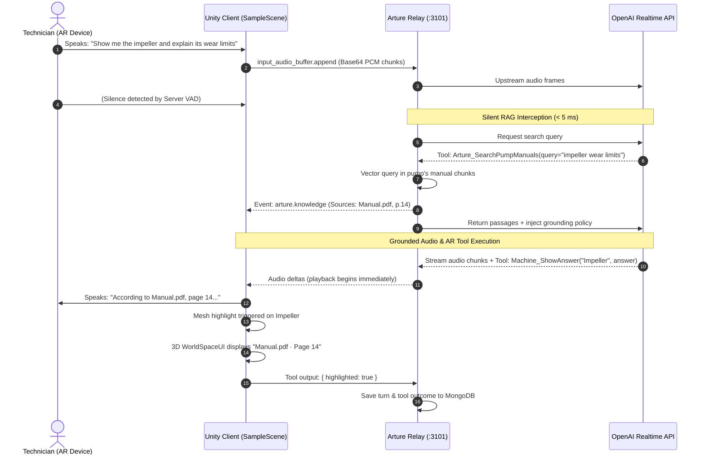

# Arture AR 

<div align="left">

[-222c37?style=for-the-badge&logo=unity&logoColor=white)](https://unity.com/)
[](https://docs.unity3d.com/Packages/com.unity.xr.arfoundation@6.4/manual/index.html)
[](https://docs.unity3d.com/Packages/com.unity.xr.interaction.toolkit@3.4/manual/index.html)
[-412991?style=for-the-badge&logo=openai&logoColor=white)](https://developers.openai.com/api/docs/guides/voice-websockets)
[](https://unity.com/)

</div>

---

**Arture AR** is an intelligent spatial operating system for industrial maintenance. It bridges physical machinery and operational knowledge by overlaying an interactive, real-time digital twin onto industrial equipment — starting with the **Centrifugal Water Pump** (`ATR-DEMO-PUMP-001`).

Technicians wear a headset or hold a tablet, speak naturally to ask diagnostic questions, and receive grounded voice instructions while the exact mechanical components (impeller, mechanical seal, bearings) illuminate in physical space.

---

## 📑 Table of Contents

- [The Big Picture](#-the-big-picture)
- [How It Works (System Architecture)](#-how-it-works-system-architecture)
- [Core Engineering Highlights](#-core-engineering-highlights)
- [Repository Map](#-repository-map)
- [Prerequisites](#-prerequisites)
- [Quick Start Guide](#-quick-start-guide)
  - [1. Connect to the Arture Relay](#1-connect-to-the-arture-relay)
  - [2. Run in the Unity Editor](#2-run-in-the-unity-editor)
  - [3. Deploy to Mobile Devices](#3-deploy-to-mobile-devices-android--ios)
- [Interactive Voice & AR Tool Catalog](#-interactive-voice--ar-tool-catalog)
- [Why We Built It This Way](#-why-we-built-it-this-way-human-design-notes)
- [Troubleshooting](#-troubleshooting)

---

## 🎯 The Big Picture

```
   ┌─────────────────────────────────────────────────────────────┐
   │                       Technician in AR                      │
   │  "Hey Arture, why is this pump losing discharge pressure?"  │
   └──────────────────────────────┬──────────────────────────────┘
                                  │ (Microphone captures 24kHz PCM)
                                  ▼
   ┌─────────────────────────────────────────────────────────────┐
   │                    Arture Voice Relay                       │
   │   1. Intercepts question                                    │
   │   2. Searches indexed pump manual in MongoDB vector store    │
   │   3. Injects citation: "Check impeller clearance, page 14"   │
   └──────────────────────────────┬──────────────────────────────┘
                                  │
                                  ▼
   ┌─────────────────────────────────────────────────────────────┐
   │                     Unity AR Viewport                       │
   │  🔊 Voice: "According to Pump_Manual.pdf, page 14, check    │
   │            the impeller wear rings."                         │
   │  ✨ Visual: Impeller mesh flashes amber in 3D AR             │
   │  🏷️ Label: 3D floating tag shows "Pump_Manual.pdf · Page 14" │
   └─────────────────────────────────────────────────────────────┘
```

---

## 📐 How It Works (System Architecture)

Unity communicates over a single, full-duplex WebSocket connection to the local or cloud-hosted **Arture Realtime Relay** (`arture-appsite` on port `3101`), which coordinates upstream conversation turns with OpenAI.



---

## ⚡ Core Engineering Highlights

### 1. Zero Audio Buffering
Audio is never saved to temporary disk files or transcoded. [`MicrophoneStreamer.cs`](file:///C:/Users/Admin/Documents/GitHub/Arture-AR-6000.4.0f1/Packages/com.convai.openai/Runtime/Common/MicrophoneStreamer.cs) reads raw audio samples, converts them into 24,000 Hz 16-bit mono PCM buffers, and streams them in real-time. [`PcmAudioPlayer.cs`](file:///C:/Users/Admin/Documents/GitHub/Arture-AR-6000.4.0f1/Packages/com.convai.openai/Runtime/Common/PcmAudioPlayer.cs) queues incoming audio packets so voice playback starts while the server is still generating the rest of the sentence.

### 2. Client-Side Security Isolation
The Unity project contains **zero OpenAI API keys**. 
- In [`ArtureRelaySettings.cs`](file:///C:/Users/Admin/Documents/GitHub/Arture-AR-6000.4.0f1/Packages/com.convai.openai/Runtime/Scripts/ArtureRelaySettings.cs), Unity actively rejects any connection URL that points directly to `openai.com` and throws an error if an `sk-...` key is supplied.
- Instead, Unity uses an internal app token (`ARTURE_RELAY_ACCESS_KEY`) that only has permission to communicate with your Arture machine relay.

### 3. Tracked Local Package
Rather than modifying disposable package cache folders, our OpenAI Realtime integration is tracked inside the repository at `Packages/com.convai.openai`. Script GUIDs and project references remain completely stable.

### 4. Natural Interruption Handling
If a technician speaks while the assistant is talking, Unity immediately triggers `response.cancel`. The playback audio queue flushes in $< 10$ milliseconds, silencing the previous answer and adapting to the new query instantly.

---

## 🗂️ Repository Map

```text
Arture-AR-6000.4.0f1/
├── Assets/
│   ├── ConvoAI/
│   │   ├── ConvoAIMicPermissionStarter.cs  # Prompts for Android/iOS mic permissions
│   │   └── ConvoAIDebugOverlay.cs          # Heads-up display for connection & RAG status
│   ├── Prefabs/
│   │   └── WaterPump.prefab                # Digital twin (bound to ATR-DEMO-PUMP-001)
│   ├── Resources/
│   │   ├── OpenAIConfig.asset              # Configuration ScriptableObject
│   │   └── ArtureRelayConnection.json      # (Ignored) Auto-synced relay tokens
│   ├── Scenes/
│   │   └── SampleScene.unity               # Primary interactive AR scene
│   └── Scripts/
│       ├── MachineComponent.cs             # Part tags, material swap, & outline logic
│       ├── MachineInteraction.cs           # Highlight, explode, and rotation animations
│       └── WorldSpaceUI.cs                 # 3D floating canvas for technician citations
└── Packages/
    └── com.convai.openai/                  # Embedded voice & relay package
        └── Runtime/
            ├── Common/
            │   ├── MicrophoneStreamer.cs   # 24kHz raw PCM microphone capture
            │   └── PcmAudioPlayer.cs       # Low-latency ring-buffer audio streamer
            └── Scripts/
                ├── ArtureRelaySettings.cs          # Credential & endpoint guard
                ├── RealtimeConversationManager.cs  # State machine, WebSocket, tool binding
                └── ToolBindings.cs                 # Maps AI function calls to Unity methods
```

---

## 🛠️ Prerequisites

- **Unity Editor**: `6000.4.0f1` (Unity 6)
- **XR Packages**: AR Foundation 6.4+, XR Interaction Toolkit 3.4+, ARCore / ARKit XR Plugins
- **Physical Device**:
  - **Android**: Device supporting Google Play Services for AR (Android 10+)
  - **iOS**: iPhone or iPad supporting ARKit (iOS 14+)
- **Backend**: A running instance of `arture-appsite` (default relay on port `3101`)

---

## 🚀 Quick Start Guide

### 1. Connect to the Arture Relay
The easiest way to configure Unity is using the automatic sync script from the website repository:

```powershell
cd ..\arture-appsite
npm run relay:configure-unity
```

This scans your local network interfaces, locates your machine's LAN IP, and generates `Assets/Resources/ArtureRelayConnection.json`:

```json
{
  "url": "ws://127.0.0.1:3101/realtime",
  "deviceUrl": "ws://192.168.1.150:3101/realtime",
  "accessToken": "your-relay-secret",
  "assetCode": "ATR-DEMO-PUMP-001"
}
```

### 2. Run in the Unity Editor
1. Start the Arture local backend:
   ```powershell
   cd ..\arture-appsite
   npm run start:local
   ```
2. Open `Arture-AR-6000.4.0f1` in Unity Hub.
3. Open `Assets/Scenes/SampleScene.unity`.
4. Press **Play**.
5. Check the debug overlay on top:
   - **State**: `connected`
   - **Machine**: `Centrifugal Water Pump (ATR-DEMO-PUMP-001)`
6. Say: *"Show me the impeller and describe what it does."*

### 3. Deploy to Mobile Devices (Android / iOS)
1. Ensure your phone and development PC are on the **same Wi-Fi network**.
2. In `Assets/Resources/ArtureRelayConnection.json`, ensure `deviceUrl` contains your PC's LAN IP (not `127.0.0.1`).
3. In Unity: **File → Build Settings**.
4. Select **Android** (or **iOS**) and click **Build and Run**.
5. When the app launches, grant Camera and Microphone permissions.
6. Point the camera at a flat surface; place the digital pump twin and start speaking.

---

## 🧰 Interactive Voice & AR Tool Catalog

When OpenAI generates a response, it can call any of the registered AR tools to manipulate the 3D pump in real time:

| AI Tool Call | Arguments | Real-World AR Action |
| :--- | :--- | :--- |
| `Machine_ShowAnswer` | `component`, `answer` | Flashes the component in 3D, displays the answer text, and attaches manual citations (`Pump Manual.pdf · Page 14`). |
| `Machine_HighlightComponent` | `component`, `color` | Illuminates a specific part (e.g. `Impeller`, `Shaft`, `Mechanical Seal`, `Bearing Housing`). |
| `Machine_ExplodeView` | `distance` | Animates the pump into an exploded assembly view to reveal internal components. |
| `Machine_RotatePump` | `axis`, `degrees` | Rotates the 3D model so the technician can inspect hidden angles. |
| `Machine_ResetView` | *none* | Re-assembles all components into the resting operating state. |

---

## 💡 Why We Built It This Way (Human Design Notes)

> *"Why not just call OpenAI directly from Unity?"*
> 
> Because in industrial spatial computing, **hallucinations can cause physical damage or safety violations**. 
> 
> If a technician asks for the torque specification on a pump casing, an ungrounded LLM will happily invent a plausible-sounding number (e.g. "Torque to 45 ft-lbs"). If the manual specifies 85 ft-lbs, you have a leaking pump under high pressure.
>
> By placing the **Arture Relay** in the middle:
> 1. We keep your OpenAI secret keys safe on the server (client APKs are easily decompiled).
> 2. We silently intercept every question, search the uploaded PDF manual in MongoDB in **2 ms**, and force the AI to cite the exact manual page.
> 3. Every single spoken word, citation, and component highlight is recorded in MongoDB and audited on the website dashboard.

---

## 🔍 Troubleshooting

| Symptom | Probable Cause | Action |
| :--- | :--- | :--- |
| **`Unity must connect to the Arture relay`** | `OpenAIConfig.asset` was accidentally configured with an `openai.com` URL. | Run `npm run relay:configure-unity` or reset the URL to `ws://127.0.0.1:3101/realtime`. |
| **`Configure an Arture app credential`** | An OpenAI `sk-...` key was pasted into Unity. | Unity only accepts Arture relay tokens. Keep the OpenAI key in `arture-appsite/.env.local`. |
| **`Relay transport error (Connection refused)`** | The backend is not running or Windows Firewall is blocking port `3101`. | Start `npm run start:local` in `arture-appsite` and allow inbound traffic on port `3101`. |
| **No citations appear on 3D labels** | No manual has been uploaded on the website yet. | Open `http://localhost:3100/workspace`, upload the pump manual PDF, and wait for **Ready**. |
| **Mobile build doesn't connect** | Phone is attempting to connect to `127.0.0.1`. | Mobile devices cannot reach `localhost`. Re-run `npm run relay:configure-unity` to ensure `deviceUrl` has your LAN IP. |

---

<div align="center">
Built with care for spatial engineering and industrial field operations.
</div>
