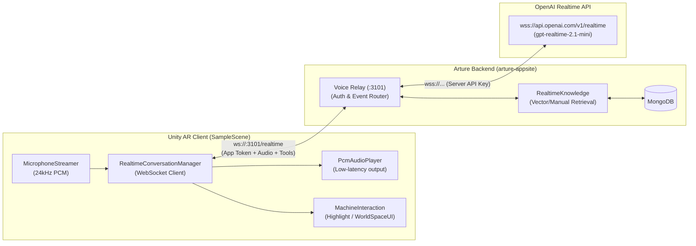

# Arture AR (Unity Client)

Spatial operating-system client for industrial maintenance and guided machine operations, built in **Unity 6 (6000.4.0f1)** with **AR Foundation** and **XR Interaction Toolkit**.

The application connects an augmented reality digital twin of a **Centrifugal Water Pump** (`ATR-DEMO-PUMP-001`) to the Arture realtime backend, providing live voice conversations grounded in uploaded technical manuals, component highlighting, and animated machine manipulation.

---

## Architecture Overview

Unity never connects directly to OpenAI. All voice audio, transcripts, and AR tool events are routed through the persistent **Arture Realtime Relay** backend.



### Key Security & Design Principles
1. **Zero Client-Side Provider Keys**: The OpenAI API key (`ARTURE_OPENAI_API_KEY`) is stored strictly on the Arture backend. Unity uses an app credential token (`ARTURE_RELAY_ACCESS_KEY`).
2. **Hard Client Enforcement**: In `ArtureRelaySettings.cs`, Unity throws a runtime exception if configured with an `openai.com` address or any key starting with `sk-`.
3. **Local Tracked Package**: Voice connection logic is maintained in an embedded package at `Packages/com.convai.openai`, avoiding modifications to disposable global package caches.
4. **Resilient Reconnection**: The client implements exponential backoff reconnection, automatic heartbeat ping/pong, and clean session termination (`arture.session.end`).

---

## Features

- **Real-Time Bidirectional Voice**: Low-latency 24 kHz PCM microphone streaming and real-time audio playback using WebSocket frames.
- **Document-Grounded Answers (RAG)**: Voice answers cite uploaded manuals (e.g. *"According to Pump Manual.pdf, page 14..."*). Citations and page references are received via `arture.knowledge` events and displayed directly on 3D world-space labels above parts.
- **3D Component Highlighting**: AI assistant tools (`Machine_ShowAnswer`, `Machine_HighlightComponent`) locate and highlight specific parts on the physical pump model (Impeller, Shaft, Mechanical Seal, Bearing Housing, Volute Casing, Discharge Flange).
- **Technician Worker Attribution**: Workers identify themselves by phone number via `arture.identify`. The backend matches verified personnel directory records and logs the session accordingly.
- **Interruption Support**: Natural speech interruption instantly cancels ongoing assistant responses and stops audio playback without stalling the connection.

---

## Project Structure

```text
Arture-AR-6000.4.0f1/
├── Assets/
│   ├── ConvoAI/                     # Microphone permissions starter and debug overlay
│   ├── Prefabs/
│   │   └── WaterPump.prefab         # Digital twin prefab (tagged ATR-DEMO-PUMP-001)
│   ├── Resources/
│   │   ├── OpenAIConfig.asset       # ScriptableObject specifying relay URL & assetCode
│   │   └── ArtureRelayConnection.json # (Ignored) Auto-generated local relay credentials
│   ├── Scenes/
│   │   └── SampleScene.unity        # Main AR interactive experience
│   └── Scripts/
│       ├── MachineComponent.cs      # Component metadata and mesh references
│       ├── MachineDefinition.cs     # Structural machine metadata
│       ├── MachineInteraction.cs    # Component highlighting, explosion, and rotation
│       ├── MachineProfile.cs        # Visual state definitions
│       └── WorldSpaceUI.cs          # 3D floating annotation panels and citations
└── Packages/
    ├── com.convai.openai/           # Embedded voice connection package
    │   └── Runtime/
    │       ├── Common/
    │       │   ├── MicrophoneStreamer.cs # 24kHz PCM microphone capture
    │       │   └── PcmAudioPlayer.cs     # Audio queue streaming playback
    │       └── Scripts/
    │           ├── ArtureRelaySettings.cs          # Settings loader & connection validator
    │           ├── OpenAIConfig.cs                 # Relay config data structure
    │           ├── RealtimeConversationManager.cs  # WebSocket lifecycle & event dispatcher
    │           └── ToolBindings.cs                 # Tool handlers mapped to Unity methods
    └── manifest.json                # Project dependencies (AR Foundation, XR Interaction Toolkit)
```

---

## Prerequisites

- **Unity Editor**: `6000.4.0f1` (Unity 6) or compatible.
- **Target Platforms**:
  - **Android**: ARCore supported device (Android 10.0+ / API level 29+ recommended).
  - **iOS**: ARKit supported device (iOS 14.0+).
  - **Editor (Mock / XR Simulation)**: XR Interaction Toolkit mock environment with desktop microphone.
- **Backend Service**: Running instance of `arture-appsite` voice relay (defaults to port `3101`).

---

## Configuration & Setup

### 1. Configure the Relay Connection

The Unity client requires an Arture relay URL and access token. 

#### Option A: Automatic Configuration via `arture-appsite` (Recommended)
From the `arture-appsite` repository root, run:
```powershell
npm run relay:configure-unity
```
This automatically detects your local LAN IP address and writes `Assets/Resources/ArtureRelayConnection.json` with:
```json
{
  "url": "ws://127.0.0.1:3101/realtime",
  "deviceUrl": "ws://<YOUR_LAN_IP>:3101/realtime",
  "accessToken": "<ARTURE_RELAY_ACCESS_KEY>",
  "assetCode": "ATR-DEMO-PUMP-001"
}
```
*(Note: `ArtureRelayConnection.json` is listed in `.gitignore` to prevent committing access tokens.)*

#### Option B: Manual Configuration
Create or edit `Assets/Resources/ArtureRelayConnection.json`:
- `url`: `ws://127.0.0.1:3101/realtime` (for Unity Editor testing on the same machine).
- `deviceUrl`: `ws://192.168.x.x:3101/realtime` or `wss://your-deployed-domain.com/realtime` (for physical mobile devices on the network).
- `accessToken`: The token matching `ARTURE_RELAY_ACCESS_KEY` in `arture-appsite/.env.local`.
- `assetCode`: Must be `ATR-DEMO-PUMP-001`.

---

## Running and Testing

### Testing in the Unity Editor
1. Start the Arture local workspace and relay:
   ```powershell
   cd ..\arture-appsite
   npm run start:local
   ```
2. Open `Arture-AR-6000.4.0f1` in Unity Hub.
3. Open scene `Assets/Scenes/SampleScene.unity`.
4. Press **Play** in the Editor.
5. In the Game view, verify the debug overlay shows:
   - **Connection State**: `connected`
   - **Machine**: `ATR-DEMO-PUMP-001`
6. Speak into your microphone (e.g. *"Show me the impeller and describe its function"*).
7. Observe:
   - Live PCM audio playback of the assistant's voice.
   - The Impeller mesh flashes/highlights in the 3D viewport.
   - The 3D world-space label displays the retrieved manual citations.

### Deploying to an Android / iOS Device
1. Ensure the mobile device is connected to the same Wi-Fi network as the machine running the Arture relay.
2. Verify that `deviceUrl` in `ArtureRelayConnection.json` points to your computer's reachable LAN IP (e.g. `ws://192.168.1.150:3101/realtime`).
3. In Unity, switch target platform to **Android** or **iOS** in **File → Build Settings**.
4. Click **Build and Run**.
5. Grant microphone and camera permissions on device startup.

---

## Troubleshooting

| Issue | Cause | Solution |
| :--- | :--- | :--- |
| `Unity must connect to the Arture relay, not directly to OpenAI` | An `openai.com` URL is configured in `OpenAIConfig.asset` or `ArtureRelayConnection.json`. | Point the URL to your Arture relay backend (`ws://127.0.0.1:3101/realtime`). |
| `Configure an Arture app credential. Do not put an OpenAI API key in Unity.` | The access token starts with `sk-` or is shorter than 24 characters. | Use the random Arture token generated in `arture-appsite`, never an OpenAI API key. |
| `[Arture] Relay transport error` | The relay process is not running or the port/LAN IP is blocked by firewall. | Ensure `npm run start:local` or `npm run relay` is running; check Windows Firewall allows port `3101`. |
| Voice answers without manual references | No manuals have been uploaded or document processing is still queued. | Upload a text PDF for the pump on `http://localhost:3100/workspace` and wait for **Ready**. |
